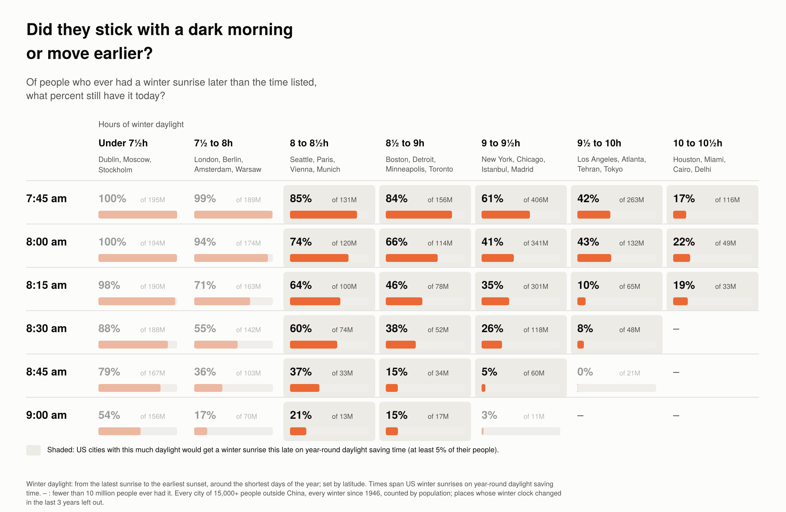
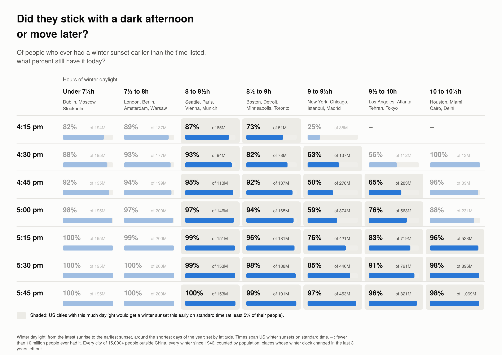

# permanent-time

Of the people who have ever lived with a late winter sunrise, how many still do? This
repository asks that of the public record: the clock history of every city of 15,000+
people since 1946 (the IANA time zone database), weighted by population. The later the
sunrise, the fewer kept it.

## The result

A clock change can't change how much daylight a place gets; it slides sunrise and sunset
together. So every city is grouped by its winter daylight (from the latest sunrise to the
earliest sunset of the year, which depends only on latitude), and sunrise and sunset are
asked about separately: of the people who have ever had a winter sunrise (the latest
sunrise of the year) later than a given time since 1946, how many still have one today? The
same for sunsets (the earliest of the year) earlier than a given time. People are counted
by today's population, in today's cities.





The later the sunrise, the fewer people kept it. In places with New York's winter daylight
(9 to 9½ hours), of the people who have ever had a winter sunrise after 8:15 am (New York
on year-round daylight saving time: 8:19), 35% still do; after 8:30, 26%; after 8:45, 5%.
In places with Boston's daylight (8½ to 9 hours), 46% after 8:15 and 38% after 8:30. In
the New York band, the people who no longer have a sunrise after 8:15 are mostly Americans,
who had one in the winter of 1974 and repealed it; the 8:45 row draws on several countries'
decisions. Early
sunsets were kept more often than late sunrises at every daylight band. At New York's own
times, of the people in its band who have ever had a winter sunset before 4:30 pm (New York
on standard time: 4:28), 63% still do, against 35% for a sunrise after 8:15. Both charts
include places that have never changed their clocks, which count as keeping whatever they
have; that affects both sides, and more of the far-north sunset side than anything else
(see the checks below).

The sunrise times shown span US winter sunrises on year-round daylight saving time; the
sunset times span US winter sunsets on standard time. Cells are shaded where at least 5% of
the people in contiguous-US cities with that much daylight would get that time; the rest
are faded. Cells with fewer than 10 million people who ever had that time show a dash.
`output/chart_post.png` is the sunrise chart trimmed to the four bands that cover the
contiguous US, and `output/chart_daylight_data.csv` has every cell, with the US share.

## Method

1. **Each city's winter clock, every winter since 1946.** For every city of 15,000+ people
   (GeoNames), the clock in force in mid-winter (15 January north of the equator, 15 July
   south of it) is read from the IANA time zone database for every year since 1946,
   whether or not the place also changes clocks for summer.
2. **Sunrise and sunset on that clock.** The latest sunrise and earliest sunset of the year,
   from NOAA's solar position formulas (the sun's upper edge on the horizon, allowing for
   refraction; they match published tables to about a minute). Day length depends only on
   latitude; the clock time of sunrise also depends on where the city sits in its time zone.
3. **Had it? Still have it?** A city has had a sunrise later than a given time if any winter
   since 1946 gave it one; it still has one if this winter's clock does.
4. **People.** Each city stands for its share of its country's city population, times the
   country's population today (World Bank).
5. **Left out.** Cities whose winter clock changed in the last 3 years, as too soon to tell.
   In 2026 that is Morocco (38 million people) and Kazakhstan (17 million), which just gave
   up late sunrises, and British Columbia, Alberta and Manitoba (12 million), Cuba and
   Paraguay, which just adopted them; the rule cuts both ways. Also China, which keeps one clock across about 60 degrees of longitude, so
   its western cities have late sunrises by fiat.

The settings are in `config.yaml`.

## Checks (`output/checks.md`)

Three things a reader should know before quoting a cell.

**Some cells rest on a few decisions.** `output/checks.md` lists, for every cell, the
countries that make up most of the people who ever had that sunrise and most of those who
still do. In the New York band, the people who no longer have a sunrise after 8:15 are
mostly the United States (1974); at 8:30 and 8:45 they are mostly Uzbekistan and
Tajikistan, which dropped Soviet "decree time" in 1991 when the USSR broke up, together
with the United States and Portugal. Of those who still have a sunrise after 8:30 in that
band, two-thirds are in Spain, which has never changed its winter clock. The Boston band
is US-dominated on the "ever had" side at every row.

**Cities that never changed their clocks.** They count as still having whatever sunrise
they have. Counting only cities whose winter clock has changed at least once, the New York
band reads 34%, 26%, 11% and 3% at 8:00, 8:15, 8:30 and 8:45 am; the pattern is the same
and steeper, and the same holds in the other bands.

**China.** Including it raises most cells by a few points, since its cities count as having
kept whatever sunrise they have: the New York band becomes 48%, 37%, 28% and 8% at 8:00,
8:15, 8:30 and 8:45 am.

Two further things worth knowing: the early-sunset side of the sunset chart is largely
places that have always had early sunsets and never changed their clocks, so it shows what
people put up with rather than what they tried and gave up; and a few steps go the other
way (7:45 to 8:00 in the 9½-to-10-hour band, 42% to 43%; two steps in the 10-to-10½-hour
band; 8:45 to 9:00 in the Boston band is flat), so "the later the sunrise, the fewer kept
it" is a pattern, not a rule in every cell.

## Run it

```
./scripts/setup_data.sh            # fetch the pinned clock-history and population data (needs zic)
pip install -r requirements.txt
python -m permanent_time           # write output/
python -m pytest
```

| Output | What it is |
|---|---|
| `output/chart_daylight_sunrise.png`, `output/chart_daylight_sunset.png` | The two charts above |
| `output/chart_post.png` | The sunrise chart, trimmed to the four daylight bands that cover the contiguous US |
| `output/chart_daylight_data.csv` | Every cell of both charts, with the share of US city people who would get that time |
| `output/checks.md` | What is in each cell; cities that changed their clocks only; with China |

## Known approximations

* **Cities stand in for everyone.** People outside cities of 15,000+ are assumed to be
  split the same way as city dwellers.
* **Only the winter clock is read.** A place that adds or drops summer time without
  changing its winter clock (Arizona in 1968, Mexico in 2022) doesn't register as a change
  here, which is deliberate: the question is about winter mornings.
* **One winter date per year.** The clock is read on 15 January (15 July in the south); a
  winter-only arrangement that skipped that date would be missed.
* **The 1946 start** leaves out the wartime clock changes. Spain, France and the Benelux
  countries moved to Central European Time in 1940–45 and have kept it, with winter
  sunrises of about 8:30 to 8:45 in Madrid and Paris; here they count as places that never
  changed. Starting earlier moves the main chart little (wartime clocks that were undone
  enter and count as given up) but raises the changed-clocks-only check, since those
  countries then count as having changed and kept it.
* **Clock history before 1970** is less certain than after, as the tz maintainers note.
  Where the database applies one rule to a whole zone, every city in that zone follows it.
* **The clock data ends in 2027,** so a return already scheduled for after then is not
  visible; such places are too soon to tell anyway.

## Sources

* IANA time zone database (pinned commit in `data/tz_commit.txt`): https://github.com/eggert/tz
* World Bank total population, SP.POP.TOTL, via https://github.com/datasets/population
  (pinned commit in `data/population_commit.txt`)
* GeoNames cities with 15,000+ people (CC BY 4.0), via the `geonamescache` Python package
* NOAA solar calculation formulas: https://gml.noaa.gov/grad/solcalc/solareqns.PDF
* Notes and sources for individual clock changes: `data/curation.yaml`
